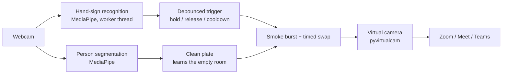

<div align="center">

# Shunshin Cam

**Flash a ✌️ on your video call and vanish in a puff of smoke, anime style.**

A real-time virtual camera for Zoom, Google Meet, Microsoft Teams, Discord and OBS.
Hold a hand sign and you disappear in a ninja smoke bomb, leaving an empty room behind.
Hold it again to come back.


</div>

---

*Shunshin no Jutsu* (瞬身の術, "Body Flicker Technique") is the move in *Naruto* where a ninja
vanishes in a burst of smoke. This project brings it to your webcam.

## Features

- **Hand-sign trigger.** Two fingers (✌️) by default, or any of 7 built-in signs.
  A short hold is required, so you won't vanish by accident while talking with your hands.
- **Procedural anime smoke.** A dense poof hides the moment you disappear, then thins into
  wisps that drift upward and leave a trail behind.
- **A believable empty room.** You aren't blurred or blacked out. The app learns what the room
  behind you looks like and shows that instead.
- **Works with any video app.** The output is a normal webcam device, so there are no plugins
  and nothing to install inside Zoom.
- **Runs locally on the CPU.** No GPU, no cloud and no account. Your video never leaves your machine.

## How it works



1. Every frame, **MediaPipe Selfie Segmentation** produces a mask of where you are.
2. Every pixel that clearly *isn't* you is folded into a **clean plate**: a continuously
   updated picture of your room without you in it.
3. A **MediaPipe Gesture Recognizer**, on its own thread, watches for the hand sign. A
   debounced trigger turns that noisy signal into one clean "toggle".
4. On trigger, a **smoke burst** spawns over your body. About 60 ms later, when the smoke is
   at its thickest, your pixels are swapped for the clean plate, so the swap itself is never visible.
5. The result is sent to a **virtual camera** that your video app picks up like a normal webcam.

## Making it look real

A naive "replace the person with a background photo" breaks the illusion within seconds.
Each giveaway is handled explicitly:

| Giveaway | What Shunshin Cam does |
| --- | --- |
| You never stepped out of frame, so the room behind you is unknown | The plate fills in **as you move**. Lean left and right once and it has seen the whole wall. Any spot it never saw gets a smooth fill from the surrounding wall. |
| Lighting changes during the call (sunset, a lamp) | The plate keeps learning from every visible pixel, so it follows slow light changes instead of freezing them. |
| Webcam auto-exposure brightens or darkens the picture | Each part of the plate remembers the exposure it was captured at and is re-matched to the current exposure. No darker "hole" where you sat. |
| The camera gets bumped | A whole-scene mismatch is detected and the plate relearns, instead of showing a room that no longer lines up. |
| A ghostly outline of you is left behind | The cut-out is grown and feathered outward, and merged with the previous frame's mask to cover segmentation lag when you move. |
| The empty area is suspiciously clean | Your camera's sensor noise is measured live and matching grain is added to the replaced area every frame. |
| You move while invisible | Every frame is re-segmented, so you stay hidden wherever you go. |
| The swap pops on screen | It happens under the densest part of the smoke, with eased timing in both directions. |
| Accidental triggers | The sign must be held (0.35 s by default), released before it can fire again, and there is a cooldown. |

## Requirements

- Python 3.10+
- A webcam
- **Windows or macOS:** [OBS Studio](https://obsproject.com) 30+ installed. Only its virtual camera
  driver is used; OBS doesn't need to be running.
- **Linux:** `v4l2loopback` (`sudo modprobe v4l2loopback devices=1`)

## Installation

```bash
git clone https://github.com/Ahmed8881/shunshin-cam.git
cd shunshin-cam
pip install -r requirements.txt
```

The two MediaPipe models (~9 MB) are downloaded automatically on first run into `models/`.

**One-time OBS setup (Windows/macOS):** open OBS, click **Start Virtual Camera**, then
**Stop Virtual Camera**, and close OBS. This registers the driver.

## Quick start

```bash
python -m shunshin
```

1. A preview window opens. The overlay (status bar and tips) is only shown to you, never to the call.
2. **Lean left and right once** so it can see the wall behind you. Watch
   *background learned* climb towards 100%.
3. In Zoom, go to **Settings → Video → Camera** and choose **OBS Virtual Camera**.
4. Hold ✌️ for a moment. *Poof.* Hold it again to come back.

> Close the preview window or press **Q** to quit. If Zoom is already using your real webcam,
> switch Zoom to *OBS Virtual Camera* first, since only one app can open a physical camera at a time.

## Usage

```text
python -m shunshin [--camera N] [--width W] [--height H] [--fps F]
                   [--gesture SIGN] [--hold SECONDS]
                   [--no-virtualcam] [--no-preview]
```

| Option | Default | Description |
| --- | --- | --- |
| `--camera` | `0` | Webcam index, if you have several. |
| `--width` / `--height` | `1280` / `720` | Capture resolution. Use `640`/`360` on slower machines. |
| `--fps` | `30` | Requested frame rate. |
| `--gesture` | `Victory` | One of `Victory`, `Thumb_Up`, `Thumb_Down`, `Open_Palm`, `Closed_Fist`, `Pointing_Up`, `ILoveYou`. |
| `--hold` | `0.35` | Seconds the sign must be held to trigger. |
| `--no-virtualcam` | off | Preview only; don't create the virtual camera. |
| `--no-preview` | off | Run without a window (stop with Ctrl+C). |

### Keyboard (preview window)

| Key | Action |
| --- | --- |
| `V` | Vanish / reappear without the hand sign |
| `B` | Forget the background and relearn it (after moving the camera or furniture) |
| `Q` / `Esc` | Quit |

## Tips for the best illusion

- **Keep the camera still.** A laptop on a desk is fine; a laptop on your lap isn't.
- **Lean aside once at the start** so the room behind your head and shoulders is captured.
  Plain walls are forgiving; busy bookshelves need a full view.
- **Good, even lighting** helps twice: the cut-out is cleaner, and webcams slow down
  (often to 10–15 fps) in dim rooms.
- **Plug in your laptop.** Windows throttles the CPU on battery.
- Put the sign where the camera sees it clearly, around chest height with your palm facing the camera.

## Known limitations

- **Shadows and reflections stay.** A shadow you cast on the wall, or your reflection in a
  window or mirror, isn't part of the person mask.
- **Held objects can float.** The segmenter is trained on people, so a mug or phone in your
  hand may stay visible when you vanish.
- **Everyone vanishes.** The mask covers every person in frame, not just the one making the sign.
- **Never-seen areas are smooth, not detailed.** If part of the room was always behind you,
  it's filled from its surroundings. That works well on plain walls and looks soft on detailed ones.
- **Big, sudden lighting changes** (switching on the main light) are treated like a bumped
  camera and the plate relearns. Areas behind you look soft until you move.
- **Performance is CPU-bound.** Expect real-time at 720p on a recent laptop when plugged in.
  Older machines should use `--width 640 --height 360`.

## Project structure

```text
shunshin/
├── __main__.py    # CLI app: capture loop, virtual camera, preview HUD
├── camera.py      # threaded webcam capture (drops stale frames)
├── perception.py  # MediaPipe person segmentation + threaded hand-sign recognition
├── trigger.py     # debounced gesture trigger (hold, release, cooldown)
├── plate.py       # self-learning clean plate: exposure matching, bump detection, hole fill, grain
├── smoke.py       # procedural anime smoke particle system
├── vanish.py      # smoke-timed, feathered swap of you for the clean plate
└── models.py      # downloads and caches the MediaPipe models
tests/             # unit tests, no camera required
```

## Running the tests

```bash
pip install pytest
python -m pytest
```

The tests use synthetic frames, so they run anywhere without a webcam.

## Acknowledgements

- [MediaPipe](https://ai.google.dev/edge/mediapipe) for the selfie segmentation and gesture recognition models
- [OpenCV](https://opencv.org) for image processing
- [pyvirtualcam](https://github.com/letmaik/pyvirtualcam) for the virtual camera output
- Masashi Kishimoto's *Naruto*, for the inspiration

## License

[MIT](LICENSE). Use it to surprise your colleagues responsibly.
